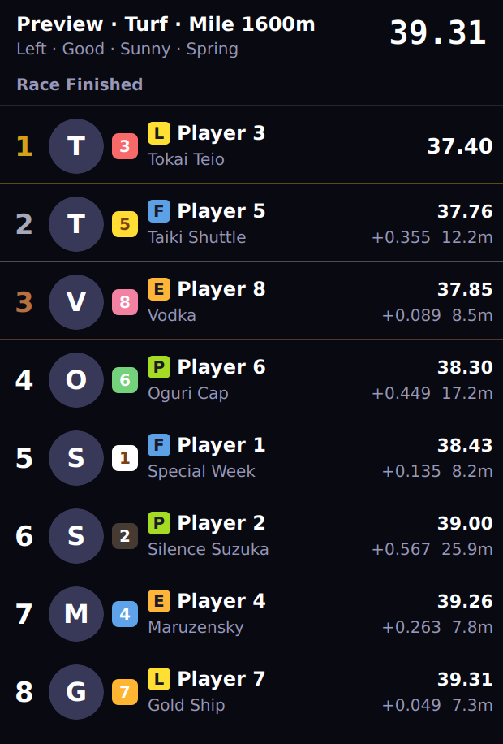
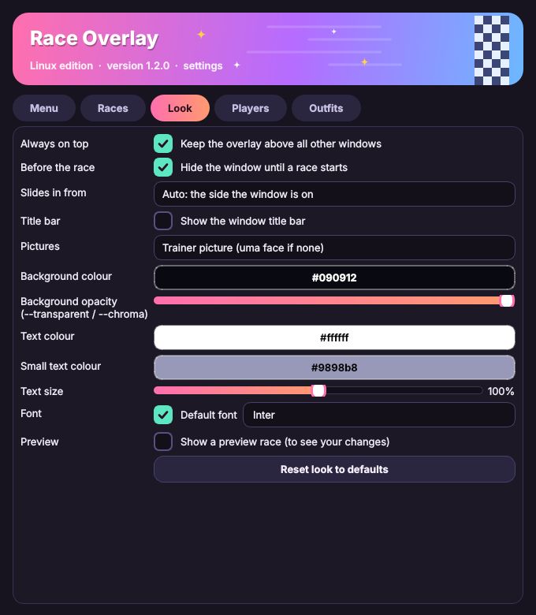
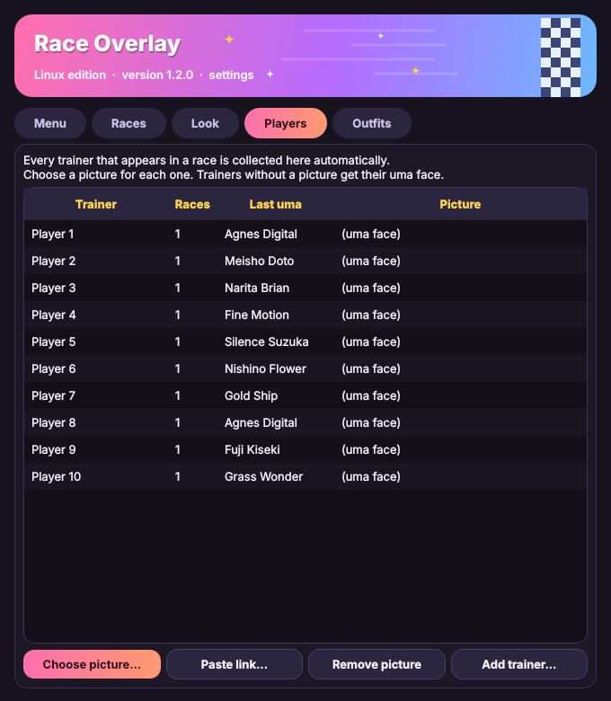
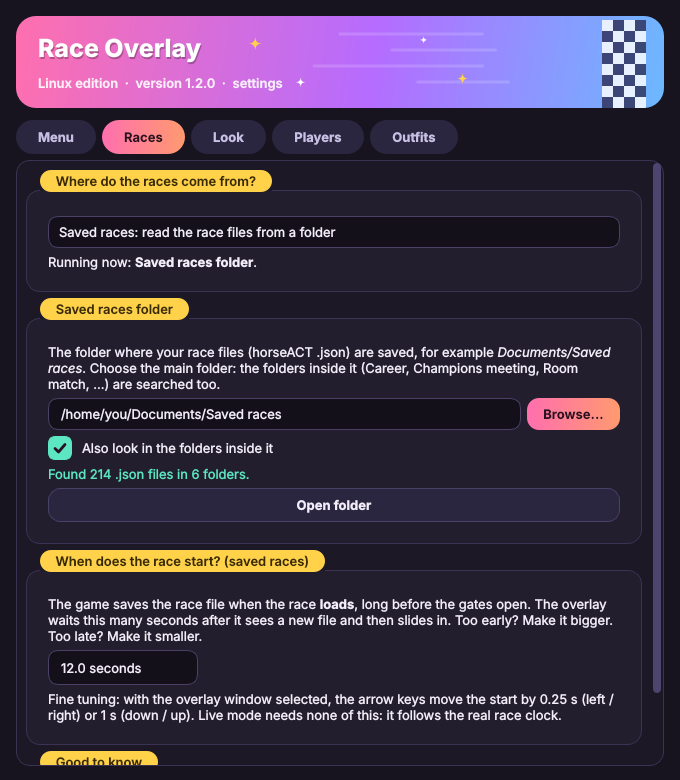
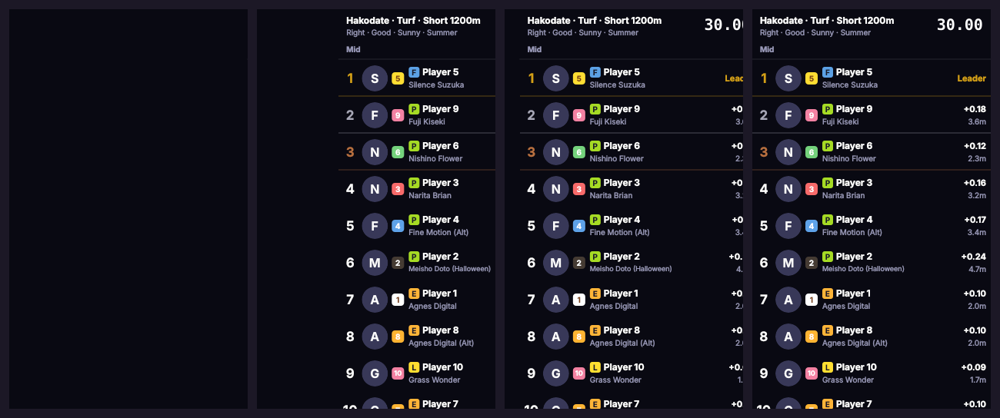
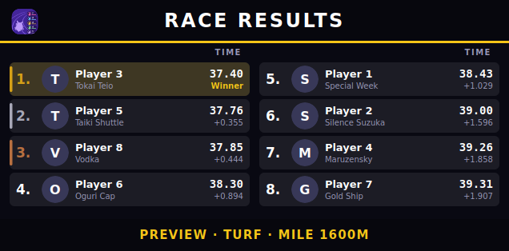
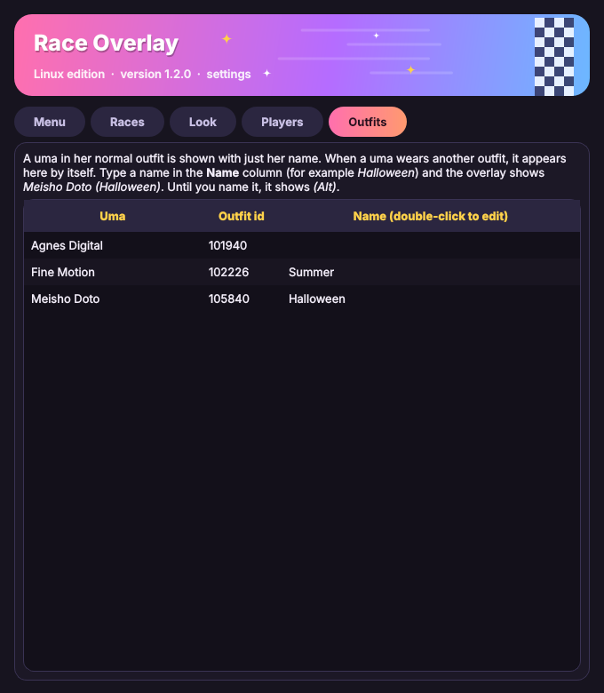

<div align="center">

# 🏇 Umamusume Race Overlay (Linux)

**A native Linux race tower for Uma Musume: Pretty Derby, made for OBS.**

-blue)




</div>

> **Why this exists:** the original *Race Overlay* runs inside Wine, and OBS often cannot see Wine's transparent windows. This program draws the same tower as a **native Linux window** that OBS can capture with a normal *Window Capture (Xcomposite)* source.

---

## 📑 Contents

- [Features](#-features)
- [Requirements](#-requirements)
- [Install](#-install)
- [Start it](#-start-it)
- [Use it in OBS](#-use-it-in-obs)
- [Player pictures and uma faces](#-player-pictures-and-uma-faces)
- [Modes](#-modes)
- [Saved races folder](#-saved-races-folder)
- [Hidden until the race, slide-in](#-hidden-until-the-race-slide-in)
- [Results board](#-results-board)
- [Tower options](#-tower-options)
- [Alternative outfits](#-alternative-outfits)
- [Wayland](#-wayland)
- [Keys and mouse](#-keys-and-mouse)
- [Command line options](#-command-line-options)
- [Updating](#-updating)
- [Folder layout](#-folder-layout)
- [Troubleshooting](#-troubleshooting)
- [Roadmap](#-roadmap)
- [Disclaimer](#-disclaimer)

---

## ✨ Features

- 📊 **Live race tower:** position, trainer, uma, running style, gate, gap in seconds and meters, finish times
- 🪟 **Native window:** works with OBS Window Capture, optional green background for Chroma Key
- 🟢 **Tray icon** with a status dot: green = working, yellow = waiting, red = problem, blue = race running
- 🗂️ **Menu window:** show/hide the overlay, preview race, settings, folder shortcuts
- 🙈 **Hidden until the race:** no overlay before the race; the tower slides in from the side of the screen it is on when the race starts, and slides out afterwards (new in 1.2.0)
- 👗 **Alternative outfits:** shown as *Meisho Doto (Halloween)*, the normal outfit as just *Meisho Doto* (new in 1.2.0)
- 🌙 **Dark settings window** with a pink, yellow and mint theme (new in 1.1.0)
- 📂 **Saved races folder:** pick the folder in Settings; the folders inside it (Career, Room match, ...) are searched too (new in 1.1.0)
- 🏁 **Results board:** after the race a second window shows the final places in two columns, like a TV results graphic, with finish times, the gap to the winner and the track name (new in 1.4.0)
- ▲▼ **Position arrows:** a small green / red arrow when a uma gains or loses a place (new in 1.4.0)
- 📏 **Auto size:** the window follows the number of umas, and shrinks to fit your screen when 18 umas are too tall; optionally show only the top N rows (new in 1.4.0)
- 🎨 **Colour sets:** Midnight, Charcoal and gold, Sakura, Mint, Daylight and High contrast in one click (new in 1.4.0)
- 🎨 **Customize:** background colour, text colour, text size, font, always on top, title bar on/off
- 🖼️ **Player pictures:** every trainer you race against is collected automatically, you just add the pictures
- 🖼️ **Uma image and player picture are separate:** the uma always keeps its own image and the player gets a small picture on its corner (or choose uma only / player only, press **T** to switch)
- 🎮 **Starts and stops with the game** (optional Steam launch option)
- ⬆️ **Built-in updater:** update from a file, or check online

---

## 📋 Requirements

- Linux with an **X11** session (Linux Mint Cinnamon is X11 by default) and **OBS**
- Python 3.9 or newer (`python3`, `python3-venv`)
- Uma Musume running through Steam/Proton
- The original **Race Overlay** (a separate community tool, **not included** here). It reads the race data from the game, and this program displays it. Put its folder (the one with `Race Overlay.exe`) next to the `app` folder (the `.gitignore` keeps it out of GitHub), or anywhere in your Documents, Downloads or Desktop folder, and the start script finds it and connects it to the game's Wine prefix for you. If it is somewhere else, write the path after `RACE_OVERLAY_DIR=` in `settings.sh`. By default only its server (`server.exe`) is started, in the background. `RACE_OVERLAY_START` in `settings.sh` can also start the whole program (`app` or `both`).

---

## 🚀 Install

1. Go to [**Releases**](../../releases/latest), download `race-overlay-native-X.Y.Z.zip` and extract it, for example to `~/Documents/race-overlay-native`. (The files you need are inside that zip. The `app/` folder in this repository holds the same files for developers.)
2. Add the icon. **No terminal needed:** double-click **Install icon (double-click)**. If your file manager asks, choose *Allow Launching* (or right-click the file, then *Properties*, then *Permissions*, then tick *Allow executing*) and double-click it again.

   A terminal works too:

   ```bash
   chmod +x *.sh
   ./install_launcher.sh
   ```

   This adds **Umamusume Race Overlay (Linux)** to your application menu and your Desktop. If the Desktop icon looks like a plain document, right-click it and choose **Allow Launching**.

3. Open `settings.sh` and check the paths (Wine prefix, Wine binary). The defaults match a Steam + GE-Proton setup, so change them if yours differ.
4. The first start installs the Python package it needs (PyQt6). A popup tells you when it starts, it takes a few minutes and only happens once.
5. If something goes wrong, a popup shows the error. The full log is `/tmp/race-overlay-native.log`.

> [!TIP]
> If you get an error mentioning `xcb` or `libxcb-cursor`, run `sudo apt install libxcb-cursor0` and start again.

---

## ▶️ Start it

Choose one:

- **Double-click the icon** after Uma Musume is running.
- **Start with the game (recommended):** in Steam, right-click Uma Musume → *Properties* → *Launch Options*, and enter (adjust the path):

  ```
  "/home/YOUR-USER/Documents/race-overlay-native/launch_with_game.sh" %command%
  ```

  The overlay now starts with the game and closes when the game closes.
- **Terminal:** `./start_auto.sh`

On start you get a **tray icon** and the **Menu** window. The overlay itself is hidden until you press **Show overlay window** (your choice is remembered).

<div align="center">

</div>

---

## 🎥 Use it in OBS

1. In the Menu, press **Show overlay window**.
2. In OBS add a **Window Capture (Xcomposite)** source and pick **Umamusume Race Overlay (Linux)**.
3. If the capture is black, start with `./start_auto.sh --chroma` and add a **Chroma Key** filter (green) to the source.

The tower shows up when a race starts and stays a few seconds after it finishes (`--hold` keeps it until the next race).

The **results board** is its own window: add a second **Window Capture (Xcomposite)** source and pick **Umamusume Race Results (Linux)**. In the Menu press **Show results board (to place it)** once to put it where you want it on the stream, then press it again to hide it. It only appears after a race.

---

## 🖼️ Player pictures and uma faces

<div align="center">

</div>

- **Players tab:** every trainer that appears in a race is added automatically. Select one and press **Choose picture...** (a file) or **Paste link...** (a web address).
- **Uma image and player picture are two different pictures.** The uma image belongs to the uma (and its outfit) and is always the same. The player picture belongs to the trainer and follows them, whatever uma they run.
- **Pictures mode** (Look tab, tray menu, right-click menu, or press **T** to cycle): *Uma image + player picture* (default: big uma image with a small player picture on its corner), *Uma image only*, or *Player picture* (in the big circle, the uma image is used when the player has none). A player without a picture simply shows no small picture.
- **Umas tab:** every uma that appears in a race is listed with her face. Select one and press **Choose picture...** to use your own, or **Use default face** to go back. Untick *Use the faces from Race Overlay...* to show only your own pictures.
- **Uma faces** are found automatically in the `character_thumbs` folder of Race Overlay inside your Wine prefix. If they are not found, copy that folder's content into `images/uma/`. To replace one, put a file named after the card id, chara id or uma name there (for example `100101.png` or `Special Week.png`).
- **Player pictures** can also be placed by hand in `images/players/`, named after the trainer (for example `Takamori.png`).

The `images/` folder is created next to the program and is not part of this repository.

---

## 🔀 Modes

| Mode | What it does |
| --- | --- |
| **live** (default, `MODE="live"` in `settings.sh`) | Uses the real race clock from Race Overlay. Starts exactly when the race starts. |
| **watch** (`MODE="watch"`) | Watches the folder where race JSON files are saved and replays the newest one. A file alone cannot tell when the race really starts, so the timing may be off. Use the arrow keys in the overlay window to adjust (left/right 0.25 s, up/down 1 s). |
| **demo** | `./start_overlay.sh --demo race.json` replays a saved race. No game needed. |

---

## 📂 Saved races folder

<div align="center">

</div>

Open the **Menu** and go to the **Races** tab:

1. **Where do the races come from?** Choose *Live* (exact, from Race Overlay), *Saved races* (read the race files from a folder), or *Follow the start script* (the default: whatever `MODE` in `settings.sh` says).
2. **Saved races folder:** press **Browse...** and choose your main folder, for example `Documents/Saved races`. Keep **Also look in the folders inside it** ticked if your files are sorted into folders such as *Career*, *Champions meeting*, *Room match* or *Team trials*.
3. The window shows how many `.json` files it found. Changing the folder works at once while the program runs. Changing the source asks you to restart.

Good to know:

- The choice made in Settings wins over `settings.sh` and over `--watch FOLDER`. It is saved in `~/.config/race-overlay-native/config.json`.
- Files that are not races (for example a list of veterans) are skipped automatically.
- "Reset look to defaults" does **not** reset your folder or source.
- A race file is written when the race **loads**, not when it starts. The overlay therefore waits **Start delay** seconds (Races tab, default 12) after it sees a new file before it slides in. If it appears too early, make the delay bigger; too late, smaller. The arrow keys in the overlay window fine-tune it (0.25 s left / right, 1 s down / up). A saved file cannot tell how long you stay on the line-up screen, so this is always an estimate. **Live** mode is exact.

---

## 🙈 Hidden until the race, slide-in

<div align="center">

</div>

- **Before the race there is no overlay.** The window stays hidden. When the race starts it appears (without taking the keyboard focus away from the game) and the tower slides in. After the race it slides out and the window hides again.
- **Which side?** *Look* tab → **Slides in from**: *Auto* uses the side of the screen the window is on (window on the right half: from the right), or force *left*, *right*, or *no sliding*.
- **Placing the window:** open the Menu and press **Show overlay window (to place it)**. Drag it where you want it, then press the button again. The position is remembered.
- **Old behaviour:** untick **Hide the window until a race starts** in the *Look* tab. Without a tray icon the window is always shown, because you could not get it back.
- **In OBS:** the *Window Capture* source is empty while the window is hidden and picks the window up again when it appears. For a clean slide (the tower sliding over your video and not over a dark box), start with `--chroma` and add a **Chroma Key** filter.
- **Live vs saved races:** in *live* mode the window appears exactly when the real race clock starts. With *saved races* the start is calculated, see [Saved races folder](#-saved-races-folder).

---

## 🏁 Results board



When the race ends the tower slides out and the results board slides in. It shows every uma in finishing order, with the finish time and the gap to the winner, and the track name at the bottom. Up to 6 umas are shown in one column, more are split into two columns. The window sizes itself to the number of umas; pull its edges to make it bigger or smaller and the size is remembered.

- It is a separate window called **Umamusume Race Results (Linux)**, so you can place it anywhere on the stream, independent of the tower.
- **Look tab:** turn it on or off, and choose how long it stays (or *Until the next race*). `--hold` keeps it until the next race too.
- It uses the same colours, font, picture choice (uma / player / both) and slide direction as the tower. The *Accent colour* is the title line and the track name.
- **Menu tab / tray menu:** *Show results board (to place it)* shows it with sample places, so you can position and style it before any race has been run.
- Equal finish times share one place. A uma without a finish time shows `--`.
- `Esc` or right click, *Hide the results board*, closes it early.

---

## 🧱 Tower options

All in the **Look** tab:

| Setting | What it does |
| --- | --- |
| **Position arrows** | A small green ▲ / red ▼ next to the rank when a uma gains or loses a place. It fades after about 2.5 seconds. Nothing shows in the first 3 seconds of a race, while everybody leaves the gates. |
| **Rows in the tower** | Show only the top N umas (*All of them* = no limit). The window gets shorter to match, and a uma that drops out of the top N slides out of view. |
| **Colour set** | One click sets the background, text, small text and accent colours. Every colour can still be changed afterwards. |
| **Auto size** | Always on (turn it off with `--no-autosize`). The height follows the rows that are shown. If the tower would be taller than your screen (for example 18 umas on a laptop), it is scaled down to fit and goes back to your own size for a smaller field. |

---

## 👗 Alternative outfits

<div align="center">

</div>

A uma in her normal outfit is shown with just her name. In another outfit the tower shows *Meisho Doto (Halloween)*. The game tells the outfits apart by an id, so the first time one appears it is added to the **Outfits** tab. Type a name there (double-click the *Name* column) and the tower uses it right away. Until it has a name it shows *(Alt)*. The names are saved in `images/outfits.json`.

---

## ⌨️ Keys and mouse

*In the overlay window:*

| Input | Action |
| --- | --- |
| Left mouse drag | Move the window (no title bar) |
| Drag an edge | Resize |
| Right click | Menu |
| `S` | Settings |
| `T` | Pictures: uma + player, uma only, player |
| `Esc` | Hide the overlay (it keeps running in the tray) |

*In the results board window:* drag to move, pull an edge to resize, right click for the menu, `Esc` to hide it.

---

## 🧰 Command line options

Run `./start_overlay.sh --help` for the full list. The most useful:

| Option | Meaning |
| --- | --- |
| `--chroma` | Solid green background for OBS Chroma Key |
| `--transparent` | Transparent window (not every setup can capture it) |
| `--show` | Show the overlay window at start |
| `--no-tray` | No tray icon, overlay always shown |
| `--game-linked` | Only work while Uma Musume is running |
| `--quit-with-game` | Close a few seconds after the game closes |
| `--watch FOLDER` | Watch mode (the folder is remembered) |
| `--demo FILE` | Replay a saved race |
| `--hold` | Keep the tower (and the results board) on screen until the next race |
| `--keep-wayland` | On a Wayland desktop, do not switch to XWayland (see [Wayland](#-wayland)) |
| `--version` | Print the version |

---

## ⬆️ Updating

Open the **Menu** and use the **Updates** section:

- **Update from file...** choose the downloaded `.zip` of the new version.
- **Check online** press the button. The link to the newest [release](../../releases/latest) is already filled in. If a newer version exists, an install button appears.

Before replacing anything, the old files are copied to `backup/`. Your pictures, player database and settings are never touched, and `settings.sh` is never overwritten.

> [!WARNING]
> Only use update links from sources you trust.

---

## 📁 Folder layout

```
README.md, CHANGELOG.md   this page and what changed in each version
.github/                  release automation and the screenshots used by this README
app/                      everything that is in the release zip:
  race_overlay_native.py    start file (kept small, all start scripts use it)
  race_overlay/             the program, one file per part:
    constants.py              names, version, layout, default settings
    config.py, util.py        saving settings, small helpers
    simdata.py                decodes the race replay data
    sources.py                live server, saved races (watch) and demo
    databases.py, images.py   players / outfits lists and picture loading
    overlay_widget.py         the overlay window and the race tower
    results_board.py          the results board window (after the race)
    frameless.py              shared by both windows: move / resize, slide side, auto size
    settings_dialog.py        the Menu / Settings window
    theme.py, tray.py         look of the settings window, tray icon
    updater.py                updating with a backup
    main.py                   command line options and start
  icon.png                  icon
  settings.sh               your paths and mode
  start_auto.sh             start everything
  start_overlay.sh          start the overlay only (sets up Python on first run)
  start_race_overlay.sh     starts Race Overlay under Wine after the game
  launch_with_game.sh       for the Steam launch option
  install_launcher.sh       creates the menu / Desktop icon
  Install icon (double-click).desktop   the same, for a double-click
  lib.sh                    popup messages used by the start scripts
  push_update.sh, release.sh  for the developer (not in the zip)
images/                   your pictures, players.json and outfits.json (created automatically, not in the repo)
backup/                   old versions kept by the updater (not in the repo)
```

Settings are stored in `~/.config/race-overlay-native/config.json`.

---

## 🖥️ Wayland

The program works best through X11. On a Wayland desktop it starts itself **through XWayland** (Qt's `xcb` platform) when it finds `XDG_SESSION_TYPE=wayland` and a `DISPLAY`, and prints a line about it. That way the window can stay on top, can be moved and resized, and shows up in OBS's window list. Set `QT_QPA_PLATFORM` yourself, or pass `--keep-wayland`, to skip this.

OBS has to see X11 windows too. If **Window Capture (Xcomposite)** is missing in OBS, or the window is not listed, start OBS through XWayland as well: `QT_QPA_PLATFORM=xcb obs`. Otherwise use OBS's PipeWire based **Window Capture** source and pick the window in the dialog your desktop shows. If Qt complains about `xcb-cursor`, install `libxcb-cursor0` (Debian / Ubuntu) or `xcb-util-cursor` (Fedora / Arch).

---

## 🛠️ Troubleshooting

| Problem | Try this |
| --- | --- |
| Nothing happens when I double-click the icon | Run `./start_auto.sh` in a terminal and read the error. Also check `/tmp/race-overlay-native.log` if you start it from Steam. |
| Status stays yellow | The game is not running yet, or its name was not found. The overlay looks for `umamusume` in process names (`GAME_MATCH` in `settings.sh`). |
| Status is red | Race Overlay is not running or not reachable. Check `/tmp/race-overlay-wine.log` and the paths in `settings.sh`. |
| `wine: failed to open "C:\Race Overlay\Race Overlay.exe": c0000135` in the log | Wine cannot start Race Overlay. Either it is installed in a different Wine prefix than `WINEPREFIX_DIR` in `settings.sh` (find it with `find ~ -iname "Race Overlay.exe"`), or that prefix is missing a runtime Race Overlay needs. Until it runs, use the **Saved races** source in the Races tab. |
| OBS shows a black window | Use `--chroma` with a Chroma Key filter. On Wayland read the [Wayland](#-wayland) section. |
| OBS cannot find the window | Press **Show overlay window** in the Menu. A hidden window cannot be captured. |
| No tray icon | Your desktop may not show tray icons. The overlay then stays visible so you can still use it (right-click for the menu). |
| Faces are letters, not pictures | The `character_thumbs` folder was not found. Copy it into `images/uma/`. |
| The tower appears before the gates open (saved races) | Raise **Start delay** in the Races tab. It is an estimate: live mode is exact. |
| The tower appears too late (saved races) | Lower **Start delay**, or nudge with the arrow keys. |
| I cannot see the overlay window | That is normal before a race: it is hidden until the race starts. Use **Show overlay window (to place it)** in the Menu, or untick **Hide the window until a race starts** in the Look tab. |
| The results board does not show after a race | Check *Show the results board after each race* in the Look tab. It appears when the tower slides out, so a race that is closed early (no finish) shows none. In OBS it is a second source: **Umamusume Race Results (Linux)**. |
| The results board is not where I want it | Press **Show results board (to place it)** in the Menu, drag it, then press the button again. The place is remembered. |
| A uma shows *(Alt)* | It is an alternative outfit without a name. Name it in the **Outfits** tab. |

---

## 🗺️ Roadmap

Planned, not released yet:

- [x] ~~**NASCAR style overlay:** full results board when the race finishes~~ (done in 1.4.0: the results board; *Rows in the tower* gives the short top-N tower)
- [ ] **Corner overlay:** a dedicated small top ~5 view during the race that grows into the results board
- [ ] **Standings board:** show every player's score after a bracket, read from a `.xlsx` / `.csv` file (or a published Google Sheets CSV link), reloaded automatically when the file changes

---

## ⚖️ Disclaimer

This is an unofficial fan project and is not affiliated with Cygames. It does not touch the game itself. It only displays data provided by the separate Race Overlay tool, which is not included in this repository. Using third-party tools with the game is at your own risk, so check the game's terms yourself. Uma Musume: Pretty Derby and its characters belong to their respective owners.

---

## 🛠️ For the developer: publishing a new version

1. Change the code in `app/`, and add a `## X.Y.Z` section at the top of `CHANGELOG.md`.
2. Run `./app/release.sh X.Y.Z`.

That commits, tags `vX.Y.Z` and pushes. GitHub then builds `race-overlay-native-X.Y.Z.zip` and `latest.json` and publishes them as a new Release, with the changelog text as the release notes. The online updater in the program reads that `latest.json`.
