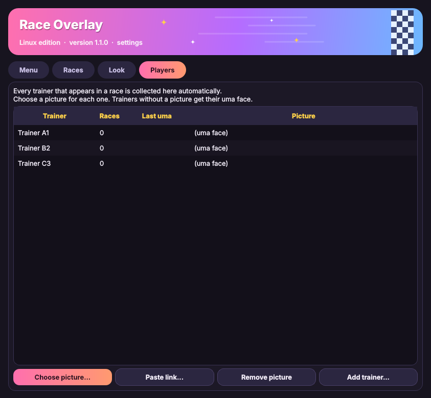
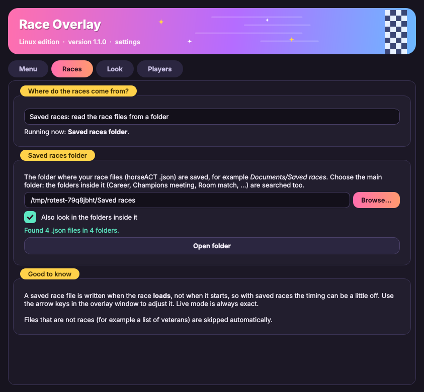

<div align="center">

# 🏇 Umamusume Race Overlay (Linux)

**A native Linux race tower for Uma Musume: Pretty Derby, made for OBS.**

-blue)


</div>

> **Why this exists:** the original *Race Overlay* runs inside Wine, and OBS often cannot see Wine's transparent windows. This program draws the same tower as a **native Linux window** that OBS can capture with a normal *Window Capture (Xcomposite)* source.

---

## 📑 Contents

- [Features](#-features)
- [Requirements](#-requirements)
- [Install](#-install)
- [Start it](#-start-it)
- [Use it in OBS](#-use-it-in-obs)
- [Player pictures and uma faces](#-player-pictures-and-uma-faces)
- [Modes](#-modes)
- [Saved races folder](#-saved-races-folder)
- [Keys and mouse](#-keys-and-mouse)
- [Command line options](#-command-line-options)
- [Updating](#-updating)
- [Folder layout](#-folder-layout)
- [Troubleshooting](#-troubleshooting)
- [Roadmap](#-roadmap)
- [Disclaimer](#-disclaimer)

---

## ✨ Features

- 📊 **Live race tower:** position, trainer, uma, running style, gate, gap in seconds and meters, finish times
- 🪟 **Native window:** works with OBS Window Capture, optional green background for Chroma Key
- 🟢 **Tray icon** with a status dot: green = working, yellow = waiting, red = problem, blue = race running
- 🗂️ **Menu window:** show/hide the overlay, preview race, settings, folder shortcuts
- 🌙 **Dark settings window** with a pink, yellow and mint theme (new in 1.1.0)
- 📂 **Saved races folder:** pick the folder in Settings; the folders inside it (Career, Room match, ...) are searched too (new in 1.1.0)
- 🎨 **Customize:** background colour, text colour, text size, font, always on top, title bar on/off
- 🖼️ **Player pictures:** every trainer you race against is collected automatically, you just add the pictures
- 🔁 **One-click switch** between trainer pictures and uma faces (or press **T**)
- 🎮 **Starts and stops with the game** (optional Steam launch option)
- ⬆️ **Built-in updater:** update from a file, or check online

---

## 📋 Requirements

- Linux with an **X11** session (Linux Mint Cinnamon is X11 by default) and **OBS**
- Python 3.9 or newer (`python3`, `python3-venv`)
- Uma Musume running through Steam/Proton
- The original **Race Overlay** (a separate community tool, **not included** here), installed in the same Wine prefix as the game. It reads the race data from the game, and this program displays it.

---

## 🚀 Install

1. Download this repository (green **Code** button → **Download ZIP**) and extract it, for example to `~/Documents/race-overlay-native`.
2. Open a terminal in that folder and run:

   ```bash
   chmod +x *.sh
   ./install_launcher.sh
   ```

   This adds **Umamusume Race Overlay (Linux)** to your application menu and your Desktop. If the Desktop icon looks like a plain document, right-click it and choose **Allow Launching**.

3. Open `settings.sh` and check the paths (Wine prefix, Wine binary). The defaults match a Steam + GE-Proton setup, so change them if yours differ.
4. The first start installs the Python package it needs (PyQt6). This takes a few minutes and only happens once.

> [!TIP]
> If you get an error mentioning `xcb` or `libxcb-cursor`, run `sudo apt install libxcb-cursor0` and start again.

---

## ▶️ Start it

Choose one:

- **Double-click the icon** after Uma Musume is running.
- **Start with the game (recommended):** in Steam, right-click Uma Musume → *Properties* → *Launch Options*, and enter (adjust the path):

  ```
  "/home/YOUR-USER/Documents/race-overlay-native/launch_with_game.sh" %command%
  ```

  The overlay now starts with the game and closes when the game closes.
- **Terminal:** `./start_auto.sh`

On start you get a **tray icon** and the **Menu** window. The overlay itself is hidden until you press **Show overlay window** (your choice is remembered).

<div align="center">

</div>

---

## 🎥 Use it in OBS

1. In the Menu, press **Show overlay window**.
2. In OBS add a **Window Capture (Xcomposite)** source and pick **Umamusume Race Overlay (Linux)**.
3. If the capture is black, start with `./start_auto.sh --chroma` and add a **Chroma Key** filter (green) to the source.

The tower shows up when a race starts and stays a few seconds after it finishes (`--hold` keeps it until the next race).

---

## 🖼️ Player pictures and uma faces

<div align="center">

</div>

- **Players tab:** every trainer that appears in a race is added automatically. Select one and press **Choose picture...** (a file) or **Paste link...** (a web address).
- **Pictures mode:** *Trainer / Discord picture* uses the player's picture and falls back to the uma face. *Uma face* always shows the uma. Switch it in the **Look** tab, the tray menu or with **T**.
- **Uma faces** are found automatically in the `character_thumbs` folder of Race Overlay inside your Wine prefix. If they are not found, copy that folder's content into `images/uma/`. To replace one, put a file named after the card id, chara id or uma name there (for example `100101.png` or `Special Week.png`).
- **Player pictures** can also be placed by hand in `images/players/`, named after the trainer (for example `Takamori.png`).

The `images/` folder is created next to the program and is not part of this repository.

---

## 🔀 Modes

| Mode | What it does |
| --- | --- |
| **live** (default, `MODE="live"` in `settings.sh`) | Uses the real race clock from Race Overlay. Starts exactly when the race starts. |
| **watch** (`MODE="watch"`) | Watches the folder where race JSON files are saved and replays the newest one. A file alone cannot tell when the race really starts, so the timing may be off. Use the arrow keys in the overlay window to adjust (left/right 0.25 s, up/down 1 s). |
| **demo** | `./start_overlay.sh --demo race.json` replays a saved race. No game needed. |

---

## 📂 Saved races folder

<div align="center">

</div>

Open the **Menu** and go to the **Races** tab:

1. **Where do the races come from?** Choose *Live* (exact, from Race Overlay), *Saved races* (read the race files from a folder), or *Follow the start script* (the default: whatever `MODE` in `settings.sh` says).
2. **Saved races folder:** press **Browse...** and choose your main folder, for example `Documents/Saved races`. Keep **Also look in the folders inside it** ticked if your files are sorted into folders such as *Career*, *Champions meeting*, *Room match* or *Team trials*.
3. The window shows how many `.json` files it found. Changing the folder works at once while the program runs. Changing the source asks you to restart.

Good to know:

- The choice made in Settings wins over `settings.sh` and over `--watch FOLDER`. It is saved in `~/.config/race-overlay-native/config.json`.
- Files that are not races (for example a list of veterans) are skipped automatically.
- "Reset look to defaults" does **not** reset your folder or source.
- A race file is written when the race **loads**, not when it starts, so timing can be a little off in saved-races mode. Use the arrow keys in the overlay window to adjust it.

---

## ⌨️ Keys and mouse

*In the overlay window:*

| Input | Action |
| --- | --- |
| Left mouse drag | Move the window (no title bar) |
| Drag an edge | Resize |
| Right click | Menu |
| `S` | Settings |
| `T` | Trainer pictures / uma faces |
| `Esc` | Hide the overlay (it keeps running in the tray) |

---

## 🧰 Command line options

Run `./start_overlay.sh --help` for the full list. The most useful:

| Option | Meaning |
| --- | --- |
| `--chroma` | Solid green background for OBS Chroma Key |
| `--transparent` | Transparent window (not every setup can capture it) |
| `--show` | Show the overlay window at start |
| `--no-tray` | No tray icon, overlay always shown |
| `--game-linked` | Only work while Uma Musume is running |
| `--quit-with-game` | Close a few seconds after the game closes |
| `--watch FOLDER` | Watch mode (the folder is remembered) |
| `--demo FILE` | Replay a saved race |
| `--hold` | Keep the tower on screen until the next race |
| `--version` | Print the version |

---

## ⬆️ Updating

Open the **Menu** and use the **Updates** section:

- **Update from file...** choose a downloaded `.zip` or `race_overlay_native.py`.
- **Check online** paste the link to a `latest.json` (see `latest.json.example`) and press the button. If a newer version exists, an install button appears.

Before replacing anything, the old files are copied to `backup/`. Your pictures, player database and settings are never touched, and `settings.sh` is never overwritten.

> [!WARNING]
> Only use update links from sources you trust.

---

## 📁 Folder layout

```
race_overlay_native.py    the program
icon.png                  icon
settings.sh               your paths and mode
start_auto.sh             start everything
start_overlay.sh          start the overlay only (sets up Python on first run)
start_race_overlay.sh     starts Race Overlay under Wine after the game
launch_with_game.sh       for the Steam launch option
install_launcher.sh       creates the menu / Desktop icon
latest.json.example       example for the online updater
CHANGELOG.md              what changed in each version
docs/                     screenshots used by this README
images/                   your pictures (created automatically, not in the repo)
backup/                   old versions kept by the updater (not in the repo)
```

Settings are stored in `~/.config/race-overlay-native/config.json`.

---

## 🛠️ Troubleshooting

| Problem | Try this |
| --- | --- |
| Nothing happens when I double-click the icon | Run `./start_auto.sh` in a terminal and read the error. Also check `/tmp/race-overlay-native.log` if you start it from Steam. |
| Status stays yellow | The game is not running yet, or its name was not found. The overlay looks for `umamusume` in process names (`GAME_MATCH` in `settings.sh`). |
| Status is red | Race Overlay is not running or not reachable. Check `/tmp/race-overlay-wine.log` and the paths in `settings.sh`. |
| `wine: failed to open "C:\Race Overlay\Race Overlay.exe": c0000135` in the log | Wine cannot start Race Overlay. Either it is installed in a different Wine prefix than `WINEPREFIX_DIR` in `settings.sh` (find it with `find ~ -iname "Race Overlay.exe"`), or that prefix is missing a runtime Race Overlay needs. Until it runs, use the **Saved races** source in the Races tab. |
| OBS shows a black window | Use `--chroma` with a Chroma Key filter. Make sure you are on X11, not Wayland. |
| OBS cannot find the window | Press **Show overlay window** in the Menu. A hidden window cannot be captured. |
| No tray icon | Your desktop may not show tray icons. The overlay then stays visible so you can still use it (right-click for the menu). |
| Faces are letters, not pictures | The `character_thumbs` folder was not found. Copy it into `images/uma/`. |
| Timing is off in watch mode | Use the arrow keys in the overlay window, or switch to live mode. |

---

## 🗺️ Roadmap

Planned, not released yet:

- [ ] **NASCAR style overlay:** a small corner overlay during the race (top ~5 with rank, name and gap) that expands into a full results board when the race finishes
- [ ] **Standings board:** show every player's score after a bracket, read from a `.xlsx` / `.csv` file (or a published Google Sheets CSV link), reloaded automatically when the file changes

---

## ⚖️ Disclaimer

This is an unofficial fan project and is not affiliated with Cygames. It does not touch the game itself. It only displays data provided by the separate Race Overlay tool, which is not included in this repository. Using third-party tools with the game is at your own risk, so check the game's terms yourself. Uma Musume: Pretty Derby and its characters belong to their respective owners.
